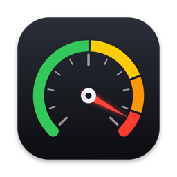
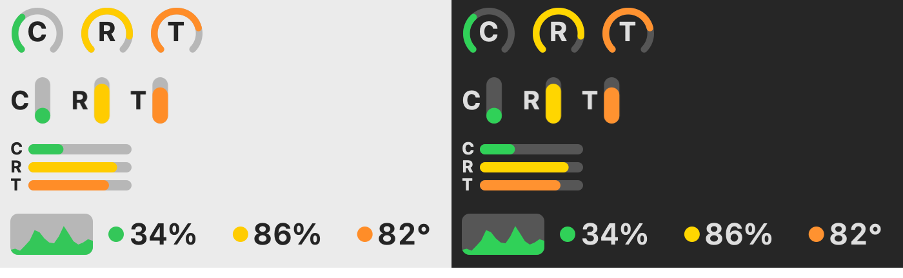

<p align="center"></p>

<h1 align="center">Redline</h1>

<p align="center">A tiny macOS menu bar monitor for CPU, memory, chip temperature and fans.<br>
Color-coded so you can tell at a glance when your Mac is heading into the red.</p>

<p align="center"></p>

## Download

**[⬇ Download Redline for Mac](https://github.com/madeby10am/Redline/releases/latest/download/Redline-1.0.dmg)**

Works on macOS 14 Sonoma or newer, on both Apple Silicon and Intel Macs.

## Install

1. Open `Redline-1.0.dmg` and drag **Redline** into **Applications**.
2. Open Redline from Applications.
3. The first time you open it, macOS says it can't verify the developer, because the app isn't notarized by Apple. Go to **System Settings → Privacy & Security**, scroll down, click **Open Anyway** next to Redline, and confirm.

   If you'd rather use Terminal, this does the same thing:

   ```bash
   xattr -dr com.apple.quarantine /Applications/Redline.app
   ```

Redline turns on **Open at login** the first time it runs. You can switch that off in its panel.

## What it shows

| | Healthy | Busy | Heavy | Too high |
|---|---|---|---|---|
| **CPU** | < 50% | 50–75% | 75–90% | > 90% |
| **Memory** | < 80% | 80–90% | 90–96% | > 96% |
| **Chip temp** | < 65°C | 65–80°C | 80–95°C | > 95°C |
| **Fan** | < 40% of max | 40–65% | 65–85% | > 85% |

Click the menu bar item to see the exact numbers, a 2-minute CPU graph, fan speed, and these settings:

- **Menu bar style**: Dials, Bars, Stacked or Graph
- **Open at login**
- Shortcuts to Activity Monitor and Quit

Redline checks your stats every 2 seconds and uses well under 1% CPU.

## Build from source

You need the Xcode Command Line Tools (`xcode-select --install`).

```bash
./build.sh           # builds build/Redline.app and dist/Redline-1.0.dmg
./build.sh install   # also installs to /Applications and launches it
```

Temperatures come from the Apple Silicon HID sensors, and fan speeds come from the SMC. On Intel Macs the temperature readout may be hidden.

## License

MIT
